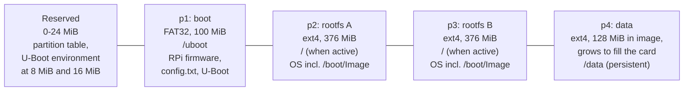

# Mender Integration Guide: Raspberry Pi 4 Model B, Yocto Project Scarthgap

| | |
|---|---|
| Title | Mender Integration Guide: Raspberry Pi 4 Model B, Yocto Project Scarthgap |
| Version | 0.1 (draft) |
| Date | 2026-11-06 |
| Author | Northern.tech |
| Customer | Chemify.io |
| SoW reference | Workstream A: Board Integration (deliverables D.1, D.2) |

This guide explains how to build, flash, boot, configure and update the Mender-enabled Yocto Project image
for the Raspberry Pi 4 Model B delivered in this repository. Every command in this guide refers to the files
in this repository. Results of the validation on hardware are in
[`02-validation-report.md`](02-validation-report.md); changes needed before production use are in
[`03-production-notes.md`](03-production-notes.md).

## Contents

1. [Overview](#1-overview)
2. [Software versions](#2-software-versions)
3. [Build host requirements](#3-build-host-requirements)
4. [Building the image](#4-building-the-image)
5. [Writing the SD card](#5-writing-the-sd-card)
6. [First boot and serial console](#6-first-boot-and-serial-console)
7. [Configuration explained](#7-configuration-explained)
8. [Boot flow and U-Boot environment](#8-boot-flow-and-u-boot-environment)
9. [Creating and installing an update](#9-creating-and-installing-an-update)
10. [Troubleshooting](#10-troubleshooting)

---

## 1. Overview

The integration provides:

- A Yocto Project Scarthgap (5.0) image (`core-image-minimal`) for the Raspberry Pi 4 Model B, 64-bit
  (`MACHINE = "raspberrypi4-64"`).
- The Mender Client (Mender Client 6.1 LTS: `mender-update` and `mender-auth` 5.2.0), started as systemd
  services `mender-updated` and `mender-authd`.
- U-Boot as bootloader, with the Mender boot logic for A/B root filesystem switching, boot counting and
  automatic rollback.
- The standard Mender partition layout: a boot partition, two root filesystem partitions (A and B) and a
  persistent data partition (SoW R.1.2). See
  [Mender: partition layout](https://docs.mender.io/operating-system-updates-yocto-project/overview#partition-layout).
- Signature verification of Mender Artifacts. The image contains a public verification key and only
  installs Artifacts signed with the matching private key (SoW R.1.4).

### 1.1 Partition layout

The SD card image (`.sdimg`) has the following layout. Sizes are those of the image as built. The data
partition is grown to the end of the SD card automatically on first boot.



| Partition | Device | File system | Size in image | Content |
|---|---|---|---|---|
| (reserved) | `/dev/mmcblk0`, 0 to 24 MiB | none | 24 MiB | Partition table; two redundant copies of the U-Boot environment at offsets 8 MiB and 16 MiB (16 KiB each) |
| p1 boot | `/dev/mmcblk0p1`, mounted at `/uboot` | FAT32 | 100 MiB | Raspberry Pi firmware, `config.txt`, U-Boot (`kernel8.img`), U-Boot script `boot.scr`, overlays. Not changed by rootfs updates |
| p2 rootfs A | `/dev/mmcblk0p2` | ext4 | 376 MiB | Complete root filesystem, including the kernel (`/boot/Image`) |
| p3 rootfs B | `/dev/mmcblk0p3` | ext4 | 376 MiB | Second root filesystem. An update is always written to the inactive one of A/B |
| p4 data | `/dev/mmcblk0p4` | ext4 | 128 MiB, then whole remaining card | Persistent data, mounted at `/data`. Holds the Mender state (`/data/mender`, reachable as `/var/lib/mender`) and the U-Boot tool configuration. Kept across updates |

The total image size is 1 GiB (`MENDER_STORAGE_TOTAL_SIZE_MB = "1024"`, the meta-mender default). On a
16 GB card the data partition was 12.8 GiB after first boot. See
[`03-production-notes.md`](03-production-notes.md) for sizing the partitions for the target storage.

---

## 2. Software versions

### 2.1 Layers

All revisions are pinned in `kas/chemify-rpi4-mender.lock.yml`. kas applies this lock file automatically.

| Layer / repository | Branch / tag | Commit | Upstream URL |
|---|---|---|---|
| bitbake | yocto-5.0.15 | `8dcf084522b9c66a6639b5f117f554fde9b6b45a` | https://git.openembedded.org/bitbake |
| openembedded-core (`meta`) | yocto-5.0.15 (scarthgap) | `6988157ad983978ffd6b12bcefedd4deaffdbbd1` | https://git.openembedded.org/openembedded-core |
| meta-yocto (`meta-poky`, `meta-yocto-bsp`) | yocto-5.0.15 (scarthgap) | `9bb6e6e8b016a0c9dfe290369a6ed91ef4020535` | https://git.yoctoproject.org/meta-yocto |
| meta-openembedded (`meta-oe`) | scarthgap | `ec0469748be4159fb83fb0fa0148d786484c88cf` | https://git.openembedded.org/meta-openembedded |
| meta-raspberrypi | scarthgap | `2c646d29912dcc873469a57b1c207e1549c5094d` | https://github.com/agherzan/meta-raspberrypi |
| meta-mender (`meta-mender-core`) | scarthgap-v2026.10.02 | `0c9dbc2a1afab7ba63f6515cf58435b6747b78db` | https://github.com/mendersoftware/meta-mender |
| meta-mender-community (`meta-mender-raspberrypi`) | scarthgap | `57f10880a166ccca9b49fa451983f44e72a39561` | https://github.com/mendersoftware/meta-mender-community |
| meta-chemify-rpi4 | in this repository | | |

`bitbake`, `openembedded-core` and `meta-yocto` together are the content of the Poky reference distribution
5.0.15. The image identifies itself as `Poky (Yocto Project Reference Distro) 5.0.15`.

### 2.2 Components in the image

| Component | Version | Notes |
|---|---|---|
| Mender Client | 6.1 (LTS) | Bundle version, see [Mender supported releases](https://docs.mender.io/release-information/supported-releases) |
| `mender-update` | 5.2.0 | Update client, service `mender-updated` |
| `mender-auth` | 5.2.0 | Authentication client, service `mender-authd` |
| `mender-config` | 5.2.0 | Configuration files |
| `mender-flash` | 1.1.0 | Used to write rootfs updates |
| `mender-client-version-inventory-script` | 6.1.0 | Reports the client version to a Mender Server |
| `libubootenv` (`fw_printenv`, `fw_setenv`) | 0.3.5 | U-Boot environment tools |
| U-Boot | 2024.01 | From meta-raspberrypi / openembedded-core |
| Linux kernel (`linux-raspberrypi`) | 6.6.63 (`6.6.63-v8`) | From meta-raspberrypi |
| `mender-artifact` (build host tool) | 4.4.2 | Built as `mender-artifact-native`, used to create and sign Artifacts |

---

## 3. Build host requirements

### 3.1 Host system

| Item | Requirement |
|---|---|
| Operating system | A Linux distribution supported by Yocto Project 5.0, see [Yocto Project: supported Linux distributions](https://docs.yoctoproject.org/5.0/ref-manual/system-requirements.html#supported-linux-distributions) (for Ubuntu: 20.04 and 22.04 LTS). This integration was built and validated on **Ubuntu 24.04 LTS** (x86-64), which is not in that list; it works with the measures in section 3.4 |
| Disk space | At least 100 GB free. A full build of this image uses about 70 GB (build output, downloads and shared-state cache) |
| Memory / CPU | 8 GB RAM minimum; 16 GB or more and 8+ CPU cores recommended. Validation host: 16 cores, 32 GB RAM |
| Network | Outbound HTTPS to GitHub, git.openembedded.org, git.yoctoproject.org and the source mirrors of the individual recipes |

### 3.2 Packages

Install the packages listed in the
[Yocto Project 5.0 documentation](https://docs.yoctoproject.org/5.0/ref-manual/system-requirements.html#ubuntu-and-debian),
plus `bmap-tools` and `pipx`. On Ubuntu 22.04:

```bash
sudo apt install gawk wget git diffstat unzip texinfo gcc build-essential chrpath socat cpio \
    python3 python3-pip python3-pexpect xz-utils debianutils iputils-ping python3-git \
    python3-jinja2 libegl1-mesa libsdl1.2-dev python3-subunit mesa-common-dev zstd \
    liblz4-tool file locales libacl1 bmap-tools pipx
sudo locale-gen en_US.UTF-8
```

On Ubuntu 24.04 the package `libegl1-mesa` no longer exists. The graphics packages (`libegl1-mesa`,
`libsdl1.2-dev`, `mesa-common-dev`) are only needed to run images in QEMU and are not needed for this
target, so omit them:

```bash
sudo apt install gawk wget git diffstat unzip texinfo gcc build-essential chrpath socat cpio \
    python3 python3-pip python3-pexpect xz-utils debianutils iputils-ping python3-git \
    python3-jinja2 python3-subunit zstd liblz4-tool file locales libacl1 bmap-tools pipx
sudo locale-gen en_US.UTF-8
```

### 3.3 kas

The build is described with [kas](https://kas.readthedocs.io/). This integration was validated with kas 4.0
(configuration format version 14):

```bash
pipx install kas==4.0
kas --version
```

You should see `kas 4.0 (configuration format version 14, ...)`. Newer kas versions are expected to work,
but were not used for this validation.

### 3.4 Known host issues (prerequisites)

#### 3.4.1 Ubuntu 24.04: AppArmor restriction on user namespaces

Ubuntu 24.04 sets `kernel.apparmor_restrict_unprivileged_userns = 1`. BitBake needs unprivileged user
namespaces and stops during its sanity check with a message that user namespaces are not usable. Check the
setting:

```bash
sysctl kernel.apparmor_restrict_unprivileged_userns
```

If the value is `1`, allow user namespaces until the next reboot:

```bash
sudo sysctl -w kernel.apparmor_restrict_unprivileged_userns=0
```

To make the setting persistent:

```bash
echo 'kernel.apparmor_restrict_unprivileged_userns = 0' | sudo tee /etc/sysctl.d/60-yocto-userns.conf
sudo sysctl --system
```

This relaxes a host-wide security restriction. Use a dedicated build host or build VM if that is a
concern.

#### 3.4.2 Host `tar` and `pseudo`: the reason for the pseudo backport

Current Ubuntu 24.04 `tar` packages (observed with `1.35+dfsg-3ubuntu0.4`) create directories with the
`openat2()` system call. The `pseudo` tool of yocto-5.0.15 does not handle `openat2()`, and the build then
fails in `do_package` of arbitrary recipes with errors such as:

```text
got *at() syscall for unknown directory, fd 4
unknown base path for fd 4, path share
couldn't allocate absolute path for 'share'.
```

The layer `meta-chemify-rpi4` therefore contains the `pseudo` 1.9.11 recipe from the openembedded-core
scarthgap branch, which supports `openat2()`. No action is needed on your side. The backport can be
removed once `openembedded-core` is pinned to **yocto-5.0.21 or later**. See
[`meta-chemify-rpi4/README.md`](../meta-chemify-rpi4/README.md).

#### 3.4.3 Networks that block `git://`

Some networks block the `git://` protocol (TCP port 9418); fetches then end with
`errno=Connection timed out`. The base configuration in meta-mender-community uses `git://` URLs for the
Yocto Project repositories. `kas/chemify-rpi4-mender.yml` overrides them with the `https://` URLs of the
same repositories; the pinned commits are unchanged. No action is needed on your side.

---

## 4. Building the image

### 4.1 Build

1. Clone this repository:

   ```bash
   git clone <repository URL> chemify-rpi4-mender
   cd chemify-rpi4-mender
   ```

2. Choose a work directory for the layer checkouts and the build output, outside the repository:

   ```bash
   export KAS_WORK_DIR=$HOME/rpi4-mender-work
   mkdir -p "$KAS_WORK_DIR"
   ```

3. Build:

   ```bash
   kas build kas/chemify-rpi4-mender.yml
   ```

kas clones all layers at the pinned commits into `$KAS_WORK_DIR`, generates `build/conf/local.conf` and
`build/conf/bblayers.conf`, and runs `bitbake core-image-minimal`.

**What you should see:** the build ends with

```text
NOTE: Tasks Summary: Attempted 4892 tasks of which ... didn't need to be rerun and all succeeded.
```

The first build takes roughly 1.5 to 2 hours on a 16-core host and uses about 70 GB of disk space.
Later builds reuse the shared-state cache and take minutes.

To open a shell with the BitBake environment, for example to run `bitbake -e`:

```bash
kas shell kas/chemify-rpi4-mender.yml
```

### 4.2 Build outputs

The outputs are in `$KAS_WORK_DIR/build/tmp/deploy/images/raspberrypi4-64/`. The files without
timestamp are symbolic links to the latest build.

| File | Use |
|---|---|
| `core-image-minimal-raspberrypi4-64.sdimg` | **Complete SD card image** with the Mender partition layout. Use it to provision a device |
| `core-image-minimal-raspberrypi4-64.sdimg.bmap` | Block map for fast, verified writing of the `.sdimg` with `bmaptool` |
| `core-image-minimal-raspberrypi4-64.mender` | **Mender Artifact** (rootfs update, unsigned). Use it to update a device that already runs this integration. Sign it before installing (section 9) |
| `core-image-minimal-raspberrypi4-64.ext4` | Root filesystem image (input for the `.mender` and `.sdimg`) |
| `core-image-minimal-raspberrypi4-64.manifest` | List of packages and versions in the image |
| `core-image-minimal-raspberrypi4-64.wic.bz2` / `.wic.bmap` | Standard meta-raspberrypi image with **two** partitions and **no** Mender layout. Do not use it with this integration |

The software version of the build is set by `MENDER_ARTIFACT_NAME` (default `chemify-rpi4-0.1.0`,
see section 7). It is stored in the `.mender` Artifact and reported by `mender-update show-artifact` on the
device.

---

## 5. Writing the SD card

Use an SD card of at least 2 GB (the image is 1 GiB). Writing the card erases all data on it.

> **Warning: choose the target device carefully.** Writing to the wrong device destroys its contents,
> for example your computer's system disk. Identify the SD card by its size and model before writing, and
> never write to a device you have not identified.

### 5.1 Linux with bmaptool (recommended, validated)

1. Insert the card and identify it:

   ```bash
   lsblk -o NAME,SIZE,MODEL,TRAN,MOUNTPOINTS
   ```

   The SD card typically shows up as `/dev/sdX` (USB card reader) or `/dev/mmcblkX` (built-in reader).
   For a stable name you can use its link in `/dev/disk/by-id/`.

2. Unmount any of its partitions that were mounted automatically, for example:

   ```bash
   sudo umount /dev/sdX?*
   ```

3. Write the image (replace `/dev/sdX` with your card):

   ```bash
   cd $KAS_WORK_DIR/build/tmp/deploy/images/raspberrypi4-64
   sudo bmaptool copy --bmap core-image-minimal-raspberrypi4-64.sdimg.bmap \
       core-image-minimal-raspberrypi4-64.sdimg /dev/sdX
   sync
   ```

**What you should see:**

```text
bmaptool: info: block map format version 2.0
bmaptool: info: 258048 blocks of size 4096 (1008.0 MiB), mapped ... blocks (...)
bmaptool: info: copying image 'core-image-minimal-raspberrypi4-64-<timestamp>.sdimg' to block device '/dev/sdX' using bmap file 'core-image-minimal-raspberrypi4-64.sdimg.bmap'
bmaptool: info: synchronizing '/dev/sdX'
bmaptool: info: copying time: 43.8s, copying speed 6.4 MiB/sec
```

Always use the `.sdimg.bmap` produced by the build. It also covers the (empty) U-Boot environment area, so
that a re-used card starts with a clean environment (see section 10).

### 5.2 Alternatives (not used during validation)

- **dd**, writes the full image (slower):

  ```bash
  sudo dd if=core-image-minimal-raspberrypi4-64.sdimg of=/dev/sdX bs=4M conv=fsync status=progress
  ```

- **Raspberry Pi Imager**: choose *Operating System -> Use custom*, select the `.sdimg` file, select the SD
  card and write. Do not apply any OS customisation settings; they are meant for Raspberry Pi OS.

---

## 6. First boot and serial console

### 6.1 Connecting a serial console

The image enables the UART on the 40-pin header at 115200 baud, 8N1, no flow control. Use a **3.3 V**
USB-to-UART adapter (a 5 V adapter can damage the Raspberry Pi).

| Raspberry Pi 4 header pin | Signal | Connect to adapter |
|---|---|---|
| 6 | GND | GND |
| 8 | GPIO14 / TXD | RXD |
| 10 | GPIO15 / RXD | TXD |

Do not connect the adapter's power pin. Open the console on the host, for example:

```bash
picocom -b 115200 /dev/ttyUSB0
```

### 6.2 Booting

Insert the SD card and power on the Raspberry Pi with a sufficient supply (5.1 V, 3 A).

**What you should see:** U-Boot, a 2-second autoboot countdown, the kernel and then a login prompt
(about 20 seconds after power-on):

```text
U-Boot 2024.01 (Jan 08 2024 - 15:37:48 +0000)

DRAM:  948 MiB (effective 3.9 GiB)
RPI 4 Model B (0xc03115)
...
Loading Environment from MMC... *** Warning - bad CRC, using default environment
...
Hit any key to stop autoboot:  2  1  0
...
Starting kernel ...
...
Poky (Yocto Project Reference Distro) 5.0.15 raspberrypi4-64 ttyS0

raspberrypi4-64 login:
```

On a new card, `bad CRC, using default environment` is expected: no U-Boot environment has been stored
yet. U-Boot uses its built-in default and saves it during the boot process.

On the first boot, the data partition is enlarged to fill the card (`EXT4-fs (mmcblk0p4): resized ...`).
The first login can take a few seconds longer while this is in progress.

### 6.3 Logging in

Log in as `root`. No password is needed in this **development** image (see section 7).

Check the state of the device:

```bash
mount | grep 'on / '
mender-update show-artifact
fw_printenv mender_boot_part upgrade_available
```

**What you should see** on a freshly written card:

```text
/dev/mmcblk0p2 on / type ext4 (rw,relatime)
chemify-rpi4-0.1.0
mender_boot_part=2
upgrade_available=0
```

The Mender services start about 2 minutes after boot when no network is connected (see section 10).
Then:

```bash
systemctl is-active mender-authd mender-updated
```

shows `active` twice.

---

## 7. Configuration explained

The configuration consists of the base configuration `kas/raspberrypi4-64.yml` from meta-mender-community
(included by `kas/chemify-rpi4-mender.yml`) and the additions in `kas/chemify-rpi4-mender.yml`. To see the
complete resulting configuration:

```bash
kas dump kas/chemify-rpi4-mender.yml
```

| Setting | Where | Value | Why | Production |
|---|---|---|---|---|
| `MACHINE` | base | `raspberrypi4-64` | Raspberry Pi 4, 64-bit (meta-raspberrypi) | Keep |
| `DISTRO`, `INIT_MANAGER` | base | `poky`, `systemd` | Reference distribution with systemd, which the Mender services use | Usually replaced by your own distribution configuration |
| `INHERIT += "mender-full"` | base | | Enables the Mender integration: client, A/B partition layout, `.sdimg` and `.mender` outputs, data partition, systemd integration. See [Mender: features](https://docs.mender.io/operating-system-updates-yocto-project/image-customization/features) | Keep |
| `RPI_USE_U_BOOT` | base | `"1"` | Boots through U-Boot instead of loading the kernel directly from the firmware. Mender needs U-Boot for A/B switching, boot counting and rollback | Keep |
| `ENABLE_UART` | base | `"1"` | Enables the serial console on GPIO14/15 (`enable_uart=1` in `config.txt`, `console=ttyS0,115200`) | Optional; consider disabling or restricting the console (see production notes) |
| `MENDER_BOOT_PART_SIZE_MB` | base | `"100"` | Size of the FAT boot partition for the Raspberry Pi firmware, U-Boot and overlays | Keep |
| `IMAGE_INSTALL:append` | base | `kernel-image kernel-devicetree` | Puts the kernel (and device tree files) into the root filesystem (`/boot`). U-Boot loads the kernel from there, so the kernel is part of every rootfs update. The device tree actually used comes from the boot partition (section 8.1) | Keep |
| `IMAGE_FSTYPES:remove` | base | `rpi-sdimg` | Removes the non-Mender Raspberry Pi SD card image type | Keep |
| meta-mender revision | this repo | `scarthgap-v2026.10.02` | Provides Mender Client 6.1 LTS (SoW R.1.1). The base configuration pins an older release with Mender Client 5.0, which is end of life | Follow Mender's LTS releases |
| Repository URLs | this repo | `https://...` | Same repositories and commits as the base configuration, over HTTPS (section 3.4.3) | Keep |
| `MENDER_ARTIFACT_NAME` | this repo (kas `env`) | `chemify-rpi4-0.1.0` | Name of the software version. **Must be different for every update.** Overridable from the shell (section 9) | Set by your release process |
| `MENDER_FEATURES_ENABLE:append = " mender-prepopulate-inactive-partition"` | this repo | | Writes the root filesystem into both rootfs A and rootfs B of the `.sdimg`. Without it, rootfs B is empty until the first update, and the bootloader checks of the integration checklist cannot switch to it | Optional |
| `EXTRA_IMAGE_FEATURES += "allow-empty-password empty-root-password allow-root-login"` | this repo | | **Development only.** Allows `root` to log in without a password | **Remove** |
| Verification key (`artifact-verify-key.pem`) | `meta-chemify-rpi4` | RSA 3072 public key (Northern.tech development key) | The client only installs Artifacts signed with the matching private key. `ArtifactVerifyKey` is set in `/etc/mender/mender.conf` automatically | **Replace** with your own key before your first build (section 9.2) |
| `pseudo` 1.9.11 | `meta-chemify-rpi4` | | Build host compatibility (section 3.4.2) | Remove after moving to yocto-5.0.21 or later |

Settings inherited from meta-mender defaults that you may want to change for production
(`MENDER_STORAGE_TOTAL_SIZE_MB`, `MENDER_DATA_PART_SIZE_MB`, server configuration) are discussed in
[`03-production-notes.md`](03-production-notes.md).

---

## 8. Boot flow and U-Boot environment

### 8.1 Where the kernel is loaded from

The Raspberry Pi firmware on the boot partition (p1) starts U-Boot. U-Boot reads its environment from the
SD card, selects the active root filesystem partition from `mender_boot_part`, and loads the kernel from
**`/boot/Image` inside that root filesystem** (`mender_kernel_name=Image`, `mender_uboot_root=mmc 0:<part>`).
`/boot/Image` is a symbolic link to `Image-6.6.63-v8`.

Because the kernel is part of the root filesystem, every rootfs update also updates the kernel. The files on
the boot partition (firmware, `config.txt`, overlays) are not part of a rootfs update.

The boot script `boot.scr` on the boot partition does this:

```text
fdt addr ${fdt_addr} && fdt get value bootargs /chosen bootargs
run mender_setup
mmc dev ${mender_uboot_dev}
load ${mender_uboot_root} ${kernel_addr_r} /boot/Image
booti ${kernel_addr_r} - ${fdt_addr}
run mender_try_to_recover
```

Two consequences:

- The **kernel** is always taken from the active root filesystem. The boot partition also contains a copy
  of `Image`, installed by the Raspberry Pi integration, but U-Boot does not use it. This was confirmed
  during validation: renaming `/boot/Image` in a root filesystem made that partition unbootable.
- The **device tree** passed to the kernel (`${fdt_addr}`) is the one the Raspberry Pi firmware loaded
  from the **boot partition**, including the overlays configured in `config.txt`. Device tree files in the
  root filesystem are not used. Device tree, overlay, firmware and `config.txt` changes are therefore
  **not** delivered by a rootfs update. This is a known limitation of the Raspberry Pi integration, see
  [Mender Hub: Raspberry Pi 4 Model B (Scarthgap)](https://hub.mender.io/t/raspberry-pi-4-model-b-yocto-5-0-scarthgap-and-later/7024)
  and the production notes.

> Note: the Mender integration checklist refers to a kernel file `vmlinuz-*`. On this board the
> equivalent file is `/boot/Image` in the root filesystem partition.

### 8.2 Relevant U-Boot variables

| Variable | Typical value | Meaning |
|---|---|---|
| `mender_boot_part` | `2` or `3` | Active root filesystem partition: `2` = rootfs A (`/dev/mmcblk0p2`), `3` = rootfs B (`/dev/mmcblk0p3`) |
| `mender_boot_part_hex` | `2` or `3` | Same as `mender_boot_part`, in hexadecimal, used by U-Boot commands. Always set both together |
| `upgrade_available` | `0` or `1` | `1` while an update is being tried (installed, not yet committed). Set by the Mender client on install, reset on commit or rollback |
| `bootcount` | number | Incremented by U-Boot on each boot while `upgrade_available=1` |
| `bootlimit` | `1` | If `bootcount` exceeds `bootlimit` while `upgrade_available=1`, U-Boot runs `altbootcmd` instead of the normal boot |
| `altbootcmd` | `run mender_altbootcmd; run bootcmd` | Switches `mender_boot_part`/`mender_boot_part_hex` back to the other partition, sets `upgrade_available=0`, saves the environment and boots. This is the automatic rollback |
| `mender_try_to_recover` | `if test ${upgrade_available} = 1; then reset; fi` | If loading the kernel fails during an update, U-Boot resets the board, which leads to the rollback through `altbootcmd` |

How a rollback looks on the console (failed update, kernel cannot be loaded):

```text
Failed to load '/boot/Image'
resetting ...
U-Boot 2024.01 (Jan 08 2024 - 15:37:48 +0000)
...
Warning: Bootlimit (1) exceeded. Using altbootcmd.
...
Starting kernel ...
```

### 8.3 Reading and writing the environment from Linux

Use `fw_printenv` and `fw_setenv` from `libubootenv`:

```bash
fw_printenv mender_boot_part mender_boot_part_hex upgrade_available bootcount
fw_setenv <variable> <value>
```

The tools read their configuration from `/etc/fw_env.config`:

```text
/dev/mmcblk0 0x800000 0x4000
/dev/mmcblk0 0x1000000 0x4000
```

That is two redundant copies of 16 KiB (`0x4000`) at 8 MiB (`0x800000`) and 16 MiB (`0x1000000`) from the
start of the SD card.

> Changing these variables by hand bypasses the Mender client. Do it only for diagnosis or for the
> integration checklist. Normal updates set them through `mender-update`.

---

## 9. Creating and installing an update

This section describes a **standalone** update from the command line on the device, without a Mender
Server. All commands in this section were run during the validation (see
[`02-validation-report.md`](02-validation-report.md), section 4). For managed deployments through a Mender
Server, see [Mender: deploy an operating system update](https://docs.mender.io/get-started/deploy-an-operating-system-update)
and the server settings in [`03-production-notes.md`](03-production-notes.md).

### 9.1 Build the update Artifact

Build with a new software version name:

```bash
cd chemify-rpi4-mender
export KAS_WORK_DIR=$HOME/rpi4-mender-work
MENDER_ARTIFACT_NAME=chemify-rpi4-0.1.1 kas build kas/chemify-rpi4-mender.yml
```

The new Artifact is `$KAS_WORK_DIR/build/tmp/deploy/images/raspberrypi4-64/core-image-minimal-raspberrypi4-64.mender`.
Copy it under a name of your choice before the next build replaces it.

### 9.2 Signing keys and signing the Artifact

The image only installs Artifacts signed with the private key that matches its verification key
(`/etc/mender/artifact-verify-key.pem`).

> **Generate your own key pair before your first build.** The verification key delivered in
> `meta-chemify-rpi4/recipes-mender/mender/files/artifact-verify-key.pem` is a temporary development key
> of Northern.tech, used for validation. Its private key is not part of this delivery, so a device built
> with it cannot install Artifacts that you sign.

1. Generate a key pair with OpenSSL (RSA 3072, as in
   [Mender: sign and verify](https://docs.mender.io/artifact-creation/sign-and-verify); ECDSA P-256 is also
   supported). Do this outside the repository and keep `private.key` secret:

   ```bash
   openssl genpkey -algorithm RSA -out private.key -pkeyopt rsa_keygen_bits:3072
   openssl rsa -in private.key -out public.key -pubout
   ```

2. Replace the delivered public key with yours and rebuild the image (section 4), then write the new
   `.sdimg` to your devices (section 5):

   ```bash
   cp public.key meta-chemify-rpi4/recipes-mender/mender/files/artifact-verify-key.pem
   kas build kas/chemify-rpi4-mender.yml
   ```

3. Sign each update Artifact after the build, as described below. Keep the private key outside the build
   system, as recommended by Mender.

`mender-artifact` is built as part of the image build:

```bash
MENDER_ARTIFACT=$KAS_WORK_DIR/build/tmp/sysroots-components/x86_64/mender-artifact-native/usr/bin/mender-artifact
$MENDER_ARTIFACT --version
```

Sign the Artifact and check the signature with the public key:

```bash
$MENDER_ARTIFACT sign chemify-rpi4-0.1.1.mender -k private.key -o chemify-rpi4-0.1.1-signed.mender
$MENDER_ARTIFACT validate chemify-rpi4-0.1.1-signed.mender -k public.key
```

**What you should see:** `Artifact file 'chemify-rpi4-0.1.1-signed.mender' validated successfully`.

The development key used during validation was generated with the same OpenSSL commands as in step 1.

### 9.3 Install on the device

1. Copy the signed Artifact to the device, for example to `/data` (persistent and large enough). Use any
   available method, such as `scp` over the network or a USB storage device.

2. Standalone mode requires that the `mender-updated` service is not running
   ([Mender: standalone deployment](https://docs.mender.io/artifact-creation/standalone-deployment)). Stop
   it for the current boot:

   ```bash
   systemctl stop mender-updated
   ```

3. Install:

   ```bash
   mender-update install /data/chemify-rpi4-0.1.1-signed.mender
   ```

   **What you should see:**

   ```text
   Installing artifact...
   ...
   Installed, but not committed.
   Use 'commit' to update, or 'rollback' to roll back the update.
   At least one payload requested a reboot of the device it updated.
   ```

   The new root filesystem has been written to the inactive partition, and the U-Boot environment now
   points to it (`mender_boot_part` changed, `upgrade_available=1`).

4. Reboot into the new version:

   ```bash
   reboot
   ```

5. After logging in again, stop `mender-updated` again (step 2) and check that the other partition is
   active:

   ```bash
   systemctl stop mender-updated
   mount | grep 'on / '
   fw_printenv mender_boot_part upgrade_available bootcount
   ```

   For example: `/dev/mmcblk0p3 on / ...`, `mender_boot_part=3`, `upgrade_available=1`, `bootcount=1`.

6. Decide:
   - **Commit** (keep the new version):

     ```bash
     mender-update commit
     mender-update show-artifact
     ```

     You should see `Committed.` and then `chemify-rpi4-0.1.1`. `upgrade_available` is now `0`, and the
     device stays on the new version across reboots.

   - **Roll back** (return to the previous version):

     ```bash
     mender-update rollback
     reboot
     ```

     You should see `Rolled back.` The environment points to the previous partition again, and after the
     reboot `mender-update show-artifact` shows the previous version.

If the new version does not boot at all, or the device is rebooted before the commit, U-Boot rolls back
automatically (section 8.2). After such an automatic rollback, `mender-update commit` refuses to commit
(`Upgrade failed and was reverted: refusing to commit!`), and the device stays on the previous version.

### 9.4 Rejected Artifacts

The client refuses Artifacts that are not signed with the expected key, and does not change the system:

| Artifact | Message from `mender-update install` |
|---|---|
| Not signed | `Signature verification Error: expecting signed artifact, but no signature file found` ... `System not modified.` |
| Signed with a different key | `Signature verification Error: Wrong manifest signature or wrong key` ... `System not modified.` |

---

## 10. Troubleshooting

| Symptom | Cause | Fix |
|---|---|---|
| Right after boot, `systemctl is-active mender-authd mender-updated` shows `inactive`; `systemctl list-jobs` shows them as `waiting`. About 2 minutes later they are `active`, and `systemctl is-system-running` reports `degraded` | Both services start after `network-online.target`. Without a network connection, `systemd-networkd-wait-online.service` waits until its timeout (about 2 minutes) and then fails | Expected without a network. With a network connection the services start immediately. For devices that run offline, see the production notes |
| BitBake stops in its sanity check about user namespaces | Ubuntu 24.04 AppArmor restriction | Section 3.4.1 |
| `do_package` fails with `got *at() syscall for unknown directory` / `unknown base path for fd` | Host `tar` uses `openat2()`, old `pseudo` | Already handled by the pseudo backport in `meta-chemify-rpi4` (section 3.4.2). If you see it, check that `meta-chemify-rpi4` is in `bitbake-layers show-layers` |
| Fetching layers ends with `errno=Connection timed out` for `git.openembedded.org` / `git.yoctoproject.org` | The network blocks `git://` (port 9418) | Use the URLs from `kas/chemify-rpi4-mender.yml` (HTTPS), section 3.4.3 |
| Rootfs B (`/dev/mmcblk0p3`) contains only `lost+found`; switching to it manually does not boot (`Failed to load '/boot/Image'`) | `mender-prepopulate-inactive-partition` not enabled: by default the `.sdimg` writes only rootfs A | Expected without the feature; the first update fills B. The feature is enabled in this configuration |
| Date shows 1970-01-01 after boot; Mender log lines have 1970 timestamps | The Raspberry Pi 4 has no battery-backed real-time clock, and no time synchronisation was available (no network) | Provide time synchronisation (e.g. `systemd-timesyncd` with network access) or an RTC; see the production notes. A correct clock is required for TLS connections to a Mender Server |
| After re-writing a used SD card, the device boots from rootfs B instead of A, or with old U-Boot variables | The U-Boot environment area (8 MiB and 16 MiB offsets) was not overwritten: the card was written with a block map that does not cover this area, or only partitions were written | Write the card with the `.sdimg.bmap` produced by the build (section 5.1) or with `dd` of the whole `.sdimg`. On a correctly written card, U-Boot shows `bad CRC, using default environment` on first boot |
| `mender-update install` reports `Signature verification Error` and `System not modified` | Artifact not signed, or signed with a key that does not match `/etc/mender/artifact-verify-key.pem` | Sign the Artifact with the matching private key (section 9.2) |
| `mender-update commit` reports `Upgrade failed and was reverted: refusing to commit!` | The update did not boot (or the device was rebooted before commit), and U-Boot rolled back automatically | Expected protection. Investigate why the new version failed to boot (serial console) |
| The bootloader reports `failed to open device: 'sdcard'` (not observed during this validation) | The SD card is not accessible: not inserted, not seated properly, or not connected to the Raspberry Pi | Check the card and its connection, then power-cycle |
| `Undervoltage detected!` on the console (not observed during this validation) | Insufficient power supply | Use a 5.1 V / 3 A supply and short, adequate cables |
